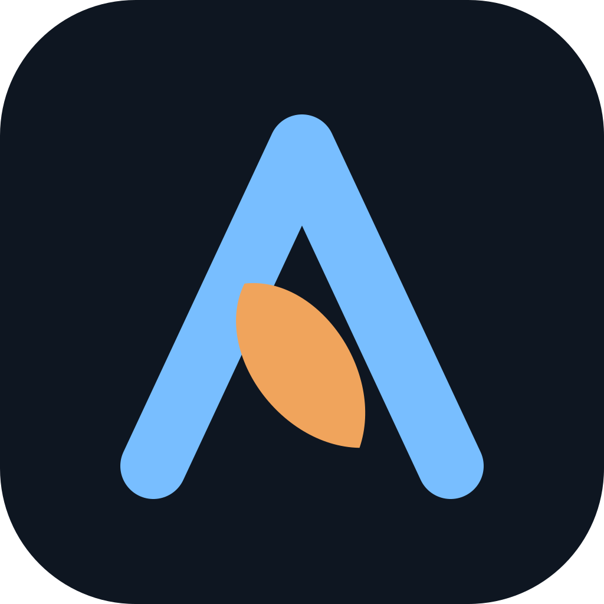
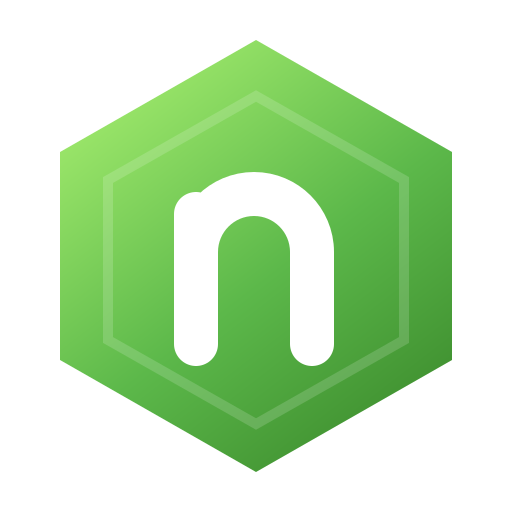
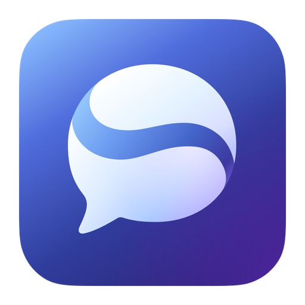
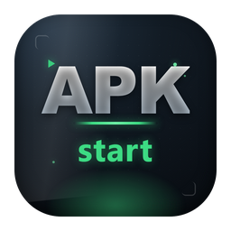

# WINFORGE

**Сайт: [d1lim0n.github.io/winforge](https://d1lim0n.github.io/winforge/)** — открывается в браузере, ничего ставить не нужно.

Каталог приложений, после которых Windows становится удобнее: кастомизация,
оптимизация, мелкие утилиты, сеть, приватность, защита. Плюс раздел с играми
и инструментами для разработки — всё в одной подборке вместо десятка вкладок
с «топ-10 программ 2019 года».

## Что это за подборка

Ставить софт на Windows неудобно не потому, что его нет, а потому, что его
слишком много и непонятно, что из этого не мусор. Здесь 46 проверенных
приложений: у каждого короткое описание, зачем он нужен, официальный сайт
и прямые ссылки на установщики для Windows и, где есть, для macOS.

Никакой рекламы, партнёрских ссылок и «скачать с нашего зеркала». Все файлы
берутся только с официальных сайтов и GitHub-репозиториев авторов.

## Приложения по категориям

Иконки и названия ведут на официальный сайт проекта. Полные описания,
скриншоты и кнопки скачивания — на сайте.

| Категория | Приложения |
| --- | --- |
| **Кастомизация** | [ Windhawk](https://windhawk.net/) · [ Rainmeter](https://www.rainmeter.net/) · [ DeskMakeover](https://github.com/nicepkg/deskmakeover) · [ Deskloom](https://apps.microsoft.com/detail/9n37b36gqq8b) · [ Nilesoft Shell](https://nilesoft.org/) · [ PhoneBox](https://github.com/ersinkoc/phonebox) |
| **Оптимизация** | [ AeroTweaks](https://aerotweaks.com/) · [ WizTree](https://diskanalyzer.com/) · [ WinToys](https://apps.microsoft.com/detail/9p8ltpgczxwg) · [ Winhance](https://winhance.net/) · [ Geek Uninstaller](https://geekuninstaller.com/) · [ Mem Reduct](https://github.com/henrypp/memreduct) · [ FluentCleaner](https://github.com/builtbybel/FluentCleaner) |
| **Разработка** | [ rust-anything](https://github.com/erkamyaman/rust-anything) · [ OpenCode](https://opencode.ai/) · [ VS Code](https://code.visualstudio.com/) · [ Node.js](https://nodejs.org/) · [ Java (JDK)](https://adoptium.net/) · [ Python](https://www.python.org/downloads/windows/) · [ VoiceMode](https://github.com/mbailey/voicemode) · [ Cursor](https://cursor.com/) · [ Git](https://git-scm.com/) · [ GitHub Desktop](https://desktop.github.com/) |
| **Сеть** | [ Happ](https://www.happ.su/) · [ Zapret-Discord](https://github.com/Flowseal/zapret-discord-youtube) · [ Oxigram](https://github.com/Timon2306/oxigram) · [ Serein](https://github.com/ViceVerse-cz/Serein) · [ RustDesk](https://rustdesk.com/) · [ qBittorrent](https://www.qbittorrent.org/) |
| **Утилиты** | [ PowerToys](https://github.com/microsoft/PowerToys) · [ Translumo](https://github.com/Danily07/Translumo) · [ Flameshot](https://flameshot.org/) · [ Deep-Live-Cam](https://github.com/hacksider/Deep-Live-Cam) · [ Wireless Battery](https://github.com/krisgfx9/Wireless-Device-Battery-Monitor) · [ LocalSend](https://localsend.org/) · [ WinRAR](https://www.win-rar.com/download.html) · [ NeDotify](https://github.com/PoviceProgrammer/NeDotify) · [ ApkStart](https://github.com/RoutineMiku/apkstart) · [ Stream Tube](https://github.com/Avaneesh-Inamdar/Stream-Tube-Desktop) · [ MarkMello](https://markmello.ru) · [ Mimic](https://github.com/Timon2306/mimic-discord) |
| **Игры** | [ EA app](https://www.ea.com/ea-app) · [ Steam](https://store.steampowered.com/about/) · [ PineconeMC](https://github.com/ElyPrismLauncher/Launcher) |
| **Приватность** | [ DuckDuckGo](https://duckduckgo.com/app) |
| **Защита** | [ Kaspersky Free](https://www.kaspersky.com/free-antivirus) |

## Как пользоваться сайтом

- **Поиск** — по названию, описанию и тегам, открывается клавишей `/`.
- **Фильтры** — по категориям, в один клик.
- **Карточка приложения** — открывает страницу `#/a/<slug>`: два сайта
  (Windows и macOS), две кнопки скачивания, полное описание и альбом
  скриншотов с лайтбоксом (стрелки, Esc, клик по фону).
- **«Собери свой пакет»** — отмечаешь нужные приложения, переключаешь
  платформу и скачиваешь выбранное подряд, без беготни по страницам.
- **Возврат в каталог** — кнопка на странице приложения возвращает к той же
  карточке и подсвечивает её, чтобы не искать место заново.

Скачивание всегда через окно подтверждения с именем файла и сайтом-источником:
случайно ничего не нажмётся.

## Оговорки

- Файлы на сайте не хранятся: кнопка ведёт прямо на официальный сайт или
  страницу релиза. Если автор удалил версию — ссылка перестанет работать,
  пока её не обновят.
- macOS есть не у всех приложений. Где нет — написано «macOS — нет версии»
  или предложен близкий аналог.
- Некоторые проекты пока в статусе alpha или beta. Это указано в описании:
  Stream Tube, например, только в alpha, а его сборка для macOS собрана
  сообществом и помечена `UNOFFICIAL`.
- PhoneBox требует установить APK на телефон и агент на компьютер.
- Windows 11 — основная цель. На Windows 10 большинство тоже работает,
  но это не проверяется.

Локально: скачай папку и открой `index.html` в браузере. Сборка не нужна,
интернет нужен только для шрифтов с Google Fonts — без них сайт тоже работает.

---

## Как это устроено

Один статический сайт без сборки, зависимостей и бэкенда. Подходит для
GitHub Pages как есть.

### Файлы

- `index.html` — разметка, лайтбокс, окно подтверждения
- `styles.css` — весь дизайн, тёмная тема, адаптив
- `app.js` — массив `APPS`, фильтры, поиск, роутинг, сборка пакета
- `icons/` — официальные иконки приложений
- `shots/` — скриншоты для страниц
- `tools/` — обновление версий
- `.nojekyll` — чтобы Pages отдавал файлы как есть

### Список приложений

Приложения лежат массивом `APPS` в начале `app.js`:

```js
{
  slug: "windhawk", name: "Windhawk", hint: "Твики без патчей",
  icon: "icons/windhawk.png", accent: "#8b5cf6", cat: "custom",
  tag: "Короткое описание для карточки",
  about: "Текст на странице приложения",
  note: "Необязательная подсказка",
  tags: ["твики", "open source"],
  url: "https://windhawk.net",
  win: { url: "https://.../windhawk_setup.exe", file: "windhawk_setup.exe" },
  mac: null,                       // или { url, file }, или macAlt: { name, url }
  shots: ["shots/windhawk/win-1.png"]
}
```

`cat` — одна из категорий: `custom`, `optimize`, `dev`, `net`, `utils`,
`games`, `privacy`, `security`. Счётчики, фильтры, бегущие строки и панель
сборки строятся из этого массива автоматически, руками их править не нужно.
Таблица с иконками выше тоже собирается из него — при добавлении приложения
допиши строку и в README.

Страница приложения — хеш `#/a/<slug>`, поэтому на Pages не нужен роутинг
на сервере. Ленты на главной собираются из `APPS` так, чтобы приложения
не повторялись между двумя строками.

### Обновление версий

`tools/update-versions.mjs` смотрит последние релизы GitHub у всех приложений
и переписывает тег и имя файла в ссылках `win`/`mac`. Правила:

- стабильный релиз важнее alpha/beta/rc; если стабильных нет совсем
  (Stream Tube) — берётся пререлиз;
- не подставляет чужие платформы: linux, apk, deb, dmg для Windows;
- Windows — x64, если в текущей ссылке не arm; macOS — arm64/dmg;
- репозиторий 404 или без релизов — пропускает, ссылку не ломает;
- ссылки не на GitHub Releases (официальные сайты, `latest/download`)
  не трогает — их обновляют вручную.

Раз в неделю одной командой:

```sh
node tools/update-and-push.mjs          # обновить, проверить, закоммитить и запушить
node tools/update-and-push.mjs --dry    # только показать, что изменится
```

Скрипт сам находит git (в том числе тот, что внутри GitHub Desktop), делает
`node --check app.js` и повторяет push до 4 раз — GitHub из РФ периодически
обрывает соединение. Если push так и не прошёл, коммит остаётся локально,
достаточно нажать Push в GitHub Desktop.

Запросы к GitHub кэшируются по ETag в `tools/.cache/` (в git не попадает):
повторный прогон не тратит лимит, потому что ответы `304` в него не считаются.
Без токена лимит — 60 запросов в час, на 23 репозитория хватает с запасом.
Если GitHub всё же ответил отказом, скрипт берёт прошлые данные из кэша
и предупреждает об этом, а не молча пропускает приложения.

### Автоматически, без рук

`.github/workflows/update-versions.yml` запускает то же самое каждые 3 дня
(07:00 МСК) и по кнопке **Actions → «Обновление версий» → Run workflow**.
Если версии изменились — бот коммитит и пушит, если нет — ничего не делает.
Для push нужно **Settings → Actions → General → Workflow permissions →
Read and write**.

### Публикация

1. **Settings → Pages → Source: Deploy from a branch → main / (root) → Save**.
2. Через минуту сайт на `https://<логин>.github.io/winforge/`.
3. Любая правка: коммит → Push origin, Pages обновляется сам.

Свой домен — **Settings → Pages → Custom domain** или файл `CNAME`.
Ограничения Pages: репозиторий до 1 ГБ, файл до 100 МБ — текущая схема
с внешними ссылками в них не упирается.
