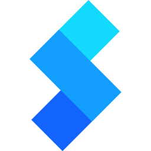
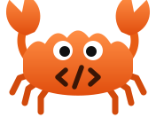
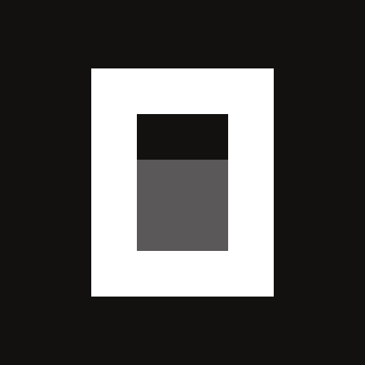
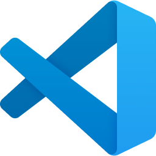
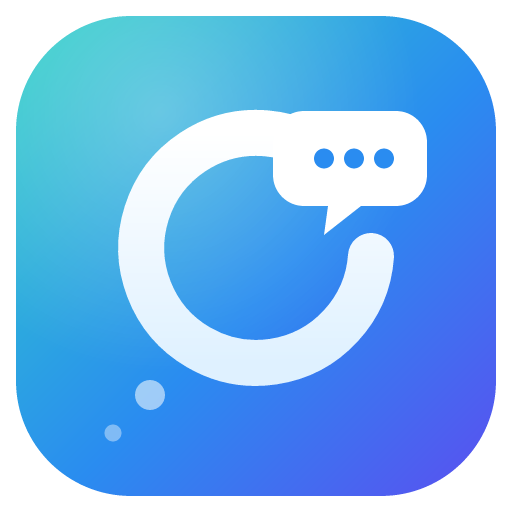
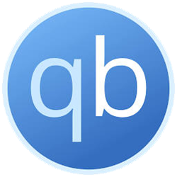
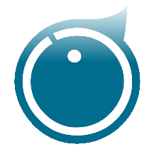
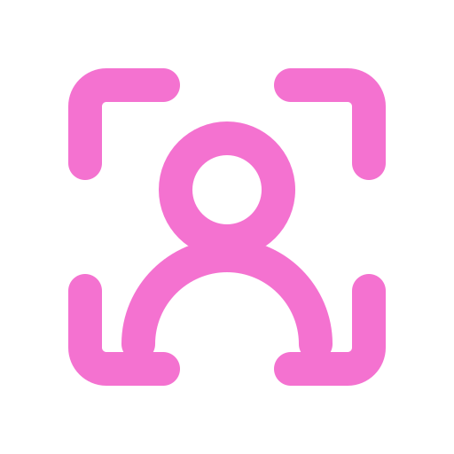

# WINFORGE

**Сайт: [d1lim0n.github.io/winforge](https://d1lim0n.github.io/winforge/)** — открывается в браузере, ничего ставить не нужно.

Каталог приложений, после которых Windows становится удобнее: кастомизация,
оптимизация, мелкие утилиты, сеть, приватность, защита. Плюс раздел с играми
и инструментами для разработки — всё в одной подборке вместо десятка вкладок
с «топ-10 программ 2019 года».

## Что это за подборка

Ставить софт на Windows неудобно не потому, что его нет, а потому, что его
слишком много и непонятно, что из этого не мусор. Здесь 49 проверенных
приложений: у каждого короткое описание, зачем он нужен, официальный сайт
и прямые ссылки на установщики для Windows и, где есть, для macOS.

Никакой рекламы, партнёрских ссылок и «скачать с нашего зеркала». Все файлы
берутся только с официальных сайтов и GitHub-репозиториев авторов.

## Приложения по категориям

Ссылка на официальный сайт проекта — на иконке. Полные описания, скриншоты
и кнопки скачивания — на сайте.

| Категория | Приложения |
| --- | --- |
| **Кастомизация** | <a href="https://windhawk.net/" title="Windhawk"></a>&nbsp;<b>Windhawk</b>&nbsp;&nbsp;·&nbsp;&nbsp;<a href="https://www.rainmeter.net/" title="Rainmeter"></a>&nbsp;<b>Rainmeter</b>&nbsp;&nbsp;·&nbsp;&nbsp;<a href="https://github.com/nicepkg/deskmakeover" title="DeskMakeover"></a>&nbsp;<b>DeskMakeover</b>&nbsp;&nbsp;·&nbsp;&nbsp;<a href="https://apps.microsoft.com/detail/9n37b36gqq8b" title="Deskloom"></a>&nbsp;<b>Deskloom</b>&nbsp;&nbsp;·&nbsp;&nbsp;<a href="https://nilesoft.org/" title="Nilesoft Shell"></a>&nbsp;<b>Nilesoft Shell</b>&nbsp;&nbsp;·&nbsp;&nbsp;<a href="https://github.com/ersinkoc/phonebox" title="PhoneBox"></a>&nbsp;<b>PhoneBox</b> |
| **Оптимизация** | <a href="https://aerotweaks.com/" title="AeroTweaks"></a>&nbsp;<b>AeroTweaks</b>&nbsp;&nbsp;·&nbsp;&nbsp;<a href="https://diskanalyzer.com/" title="WizTree"></a>&nbsp;<b>WizTree</b>&nbsp;&nbsp;·&nbsp;&nbsp;<a href="https://apps.microsoft.com/detail/9p8ltpgczxwg" title="WinToys"></a>&nbsp;<b>WinToys</b>&nbsp;&nbsp;·&nbsp;&nbsp;<a href="https://winhance.net/" title="Winhance"></a>&nbsp;<b>Winhance</b>&nbsp;&nbsp;·&nbsp;&nbsp;<a href="https://geekuninstaller.com/" title="Geek Uninstaller"></a>&nbsp;<b>Geek Uninstaller</b>&nbsp;&nbsp;·&nbsp;&nbsp;<a href="https://github.com/henrypp/memreduct" title="Mem Reduct"></a>&nbsp;<b>Mem Reduct</b>&nbsp;&nbsp;·&nbsp;&nbsp;<a href="https://github.com/builtbybel/FluentCleaner" title="FluentCleaner"></a>&nbsp;<b>FluentCleaner</b> |
| **Разработка** | <a href="https://github.com/erkamyaman/rust-anything" title="rust-anything"></a>&nbsp;<b>rust-anything</b>&nbsp;&nbsp;·&nbsp;&nbsp;<a href="https://opencode.ai/" title="OpenCode"></a>&nbsp;<b>OpenCode</b>&nbsp;&nbsp;·&nbsp;&nbsp;<a href="https://code.visualstudio.com/" title="VS Code"></a>&nbsp;<b>VS Code</b>&nbsp;&nbsp;·&nbsp;&nbsp;<a href="https://nodejs.org/" title="Node.js"></a>&nbsp;<b>Node.js</b>&nbsp;&nbsp;·&nbsp;&nbsp;<a href="https://adoptium.net/" title="Java (JDK)"></a>&nbsp;<b>Java (JDK)</b>&nbsp;&nbsp;·&nbsp;&nbsp;<a href="https://www.python.org/downloads/windows/" title="Python"></a>&nbsp;<b>Python</b>&nbsp;&nbsp;·&nbsp;&nbsp;<a href="https://github.com/mbailey/voicemode" title="VoiceMode"></a>&nbsp;<b>VoiceMode</b>&nbsp;&nbsp;·&nbsp;&nbsp;<a href="https://cursor.com/" title="Cursor"></a>&nbsp;<b>Cursor</b>&nbsp;&nbsp;·&nbsp;&nbsp;<a href="https://git-scm.com/" title="Git"></a>&nbsp;<b>Git</b>&nbsp;&nbsp;·&nbsp;&nbsp;<a href="https://desktop.github.com/" title="GitHub Desktop"></a>&nbsp;<b>GitHub Desktop</b> |
| **Сеть** | <a href="https://www.happ.su/" title="Happ"></a>&nbsp;<b>Happ</b>&nbsp;&nbsp;·&nbsp;&nbsp;<a href="https://github.com/Flowseal/zapret-discord-youtube" title="Zapret-Discord"></a>&nbsp;<b>Zapret-Discord</b>&nbsp;&nbsp;·&nbsp;&nbsp;<a href="https://github.com/Timon2306/oxigram" title="Oxigram"></a>&nbsp;<b>Oxigram</b>&nbsp;&nbsp;·&nbsp;&nbsp;<a href="https://github.com/ViceVerse-cz/Serein" title="Serein"></a>&nbsp;<b>Serein</b>&nbsp;&nbsp;·&nbsp;&nbsp;<a href="https://rustdesk.com/" title="RustDesk"></a>&nbsp;<b>RustDesk</b>&nbsp;&nbsp;·&nbsp;&nbsp;<a href="https://www.qbittorrent.org/" title="qBittorrent"></a>&nbsp;<b>qBittorrent</b> |
| **Утилиты** | <a href="https://github.com/microsoft/PowerToys" title="PowerToys"></a>&nbsp;<b>PowerToys</b>&nbsp;&nbsp;·&nbsp;&nbsp;<a href="https://github.com/Danily07/Translumo" title="Translumo"></a>&nbsp;<b>Translumo</b>&nbsp;&nbsp;·&nbsp;&nbsp;<a href="https://flameshot.org/" title="Flameshot"></a>&nbsp;<b>Flameshot</b>&nbsp;&nbsp;·&nbsp;&nbsp;<a href="https://github.com/hacksider/Deep-Live-Cam" title="Deep-Live-Cam"></a>&nbsp;<b>Deep-Live-Cam</b>&nbsp;&nbsp;·&nbsp;&nbsp;<a href="https://github.com/krisgfx9/Wireless-Device-Battery-Monitor" title="Wireless Battery"></a>&nbsp;<b>Wireless Battery</b>&nbsp;&nbsp;·&nbsp;&nbsp;<a href="https://localsend.org/" title="LocalSend"></a>&nbsp;<b>LocalSend</b>&nbsp;&nbsp;·&nbsp;&nbsp;<a href="https://www.win-rar.com/download.html" title="WinRAR"></a>&nbsp;<b>WinRAR</b>&nbsp;&nbsp;·&nbsp;&nbsp;<a href="https://github.com/PoviceProgrammer/NeDotify" title="NeDotify"></a>&nbsp;<b>NeDotify</b>&nbsp;&nbsp;·&nbsp;&nbsp;<a href="https://github.com/RoutineMiku/apkstart" title="ApkStart"></a>&nbsp;<b>ApkStart</b>&nbsp;&nbsp;·&nbsp;&nbsp;<a href="https://github.com/Avaneesh-Inamdar/Stream-Tube-Desktop" title="Stream Tube"></a>&nbsp;<b>Stream Tube</b>&nbsp;&nbsp;·&nbsp;&nbsp;<a href="https://markmello.ru" title="MarkMello"></a>&nbsp;<b>MarkMello</b>&nbsp;&nbsp;·&nbsp;&nbsp;<a href="https://github.com/Timon2306/mimic-discord" title="Mimic"></a>&nbsp;<b>Mimic</b>&nbsp;&nbsp;·&nbsp;&nbsp;<a href="https://github.com/oguz463/OLEDTextFix" title="OLEDTextFix"></a>&nbsp;<b>OLEDTextFix</b>&nbsp;&nbsp;·&nbsp;&nbsp;<a href="https://github.com/haziqahmedqasmi/peakcut" title="PeakCut"></a>&nbsp;<b>PeakCut</b> |
| **Игры** | <a href="https://www.ea.com/ea-app" title="EA app"></a>&nbsp;<b>EA app</b>&nbsp;&nbsp;·&nbsp;&nbsp;<a href="https://store.steampowered.com/about/" title="Steam"></a>&nbsp;<b>Steam</b>&nbsp;&nbsp;·&nbsp;&nbsp;<a href="https://www.xmodhub.com/uk" title="XMODhub"></a>&nbsp;<b>XMODhub</b>&nbsp;&nbsp;·&nbsp;&nbsp;<a href="https://github.com/ElyPrismLauncher/Launcher" title="PineconeMC"></a>&nbsp;<b>PineconeMC</b> |
| **Приватность** | <a href="https://duckduckgo.com/app" title="DuckDuckGo"></a>&nbsp;<b>DuckDuckGo</b> |
| **Защита** | <a href="https://www.kaspersky.com/free-antivirus" title="Kaspersky Free"></a>&nbsp;<b>Kaspersky Free</b> |

## Как пользоваться сайтом

- **Поиск** — по названию, описанию и тегам, открывается клавишей `/`.
- **Фильтры** — по категориям, в один клик.
- **Карточка приложения** — открывает страницу `#/a/<slug>`: два сайта
  (Windows и macOS), две кнопки скачивания, полное описание и альбом
  скриншотов с лайтбоксом (стрелки, Esc, клик по фону).
- **«Собери свой пакет»** — отмечаешь нужные приложения, переключаешь
  платформу и скачиваешь выбранное подряд, без беготни по страницам.
- **Возврат в каталог** — кнопка на странице приложения возвращает к той же
  карточке и подсвечивает её, чтобы не искать место заново.

Скачивание всегда через окно подтверждения с именем файла и сайтом-источником:
случайно ничего не нажмётся.

## Оговорки

- Файлы на сайте не хранятся: кнопка ведёт прямо на официальный сайт или
  страницу релиза. Если автор удалил версию — ссылка перестанет работать,
  пока её не обновят.
- macOS есть не у всех приложений. Где нет — написано «macOS — нет версии»
  или предложен близкий аналог.
- Некоторые проекты пока в статусе alpha или beta. Это указано в описании:
  Stream Tube, например, только в alpha, а его сборка для macOS собрана
  сообществом и помечена `UNOFFICIAL`.
- PhoneBox требует установить APK на телефон и агент на компьютер.
- Windows 11 — основная цель. На Windows 10 большинство тоже работает,
  но это не проверяется.

Локально: скачай папку и открой `index.html` в браузере. Сборка не нужна,
интернет нужен только для шрифтов с Google Fonts — без них сайт тоже работает.

---

## Как это устроено

Один статический сайт без сборки, зависимостей и бэкенда. Подходит для
GitHub Pages как есть.

### Файлы

- `index.html` — разметка, лайтбокс, окно подтверждения
- `styles.css` — весь дизайн, тёмная тема, адаптив
- `app.js` — массив `APPS`, фильтры, поиск, роутинг, сборка пакета
- `icons/` — официальные иконки приложений
- `shots/` — скриншоты для страниц
- `tools/` — обновление версий
- `.nojekyll` — чтобы Pages отдавал файлы как есть

### Список приложений

Приложения лежат массивом `APPS` в начале `app.js`:

```js
{
  slug: "windhawk", name: "Windhawk", hint: "Твики без патчей",
  icon: "icons/windhawk.png", accent: "#8b5cf6", cat: "custom",
  tag: "Короткое описание для карточки",
  about: "Текст на странице приложения",
  note: "Необязательная подсказка",
  tags: ["твики", "open source"],
  url: "https://windhawk.net",
  win: { url: "https://.../windhawk_setup.exe", file: "windhawk_setup.exe" },
  mac: null,                       // или { url, file }, или macAlt: { name, url }
  shots: ["shots/windhawk/win-1.png"]
}
```

`cat` — одна из категорий: `custom`, `optimize`, `dev`, `net`, `utils`,
`games`, `privacy`, `security`. Счётчики, фильтры, бегущие строки и панель
сборки строятся из этого массива автоматически, руками их править не нужно.
Таблица с иконками выше тоже собирается из него — при добавлении приложения
допиши строку и в README.

Страница приложения — хеш `#/a/<slug>`, поэтому на Pages не нужен роутинг
на сервере. Ленты на главной собираются из `APPS` так, чтобы приложения
не повторялись между двумя строками.

### Обновление версий

`tools/update-versions.mjs` смотрит последние релизы GitHub у всех приложений
и переписывает тег и имя файла в ссылках `win`/`mac`. Правила:

- стабильный релиз важнее alpha/beta/rc; если стабильных нет совсем
  (Stream Tube) — берётся пререлиз;
- не подставляет чужие платформы: linux, apk, deb, dmg для Windows;
- Windows — x64, если в текущей ссылке не arm; macOS — arm64/dmg;
- репозиторий 404 или без релизов — пропускает, ссылку не ломает;
- ссылки не на GitHub Releases (официальные сайты, `latest/download`)
  не трогает — их обновляют вручную.

Раз в неделю одной командой:

```sh
node tools/update-and-push.mjs          # обновить, проверить, закоммитить и запушить
node tools/update-and-push.mjs --dry    # только показать, что изменится
```

Скрипт сам находит git (в том числе тот, что внутри GitHub Desktop), делает
`node --check app.js` и повторяет push до 4 раз — GitHub из РФ периодически
обрывает соединение. Если push так и не прошёл, коммит остаётся локально,
достаточно нажать Push в GitHub Desktop.

Запросы к GitHub кэшируются по ETag в `tools/.cache/` (в git не попадает):
повторный прогон не тратит лимит, потому что ответы `304` в него не считаются.
Без токена лимит — 60 запросов в час, на 23 репозитория хватает с запасом.
Если GitHub всё же ответил отказом, скрипт берёт прошлые данные из кэша
и предупреждает об этом, а не молча пропускает приложения.

### Автоматически, без рук

`.github/workflows/update-versions.yml` запускает то же самое каждые 3 дня
(07:00 МСК) и по кнопке **Actions → «Обновление версий» → Run workflow**.
Если версии изменились — бот коммитит и пушит, если нет — ничего не делает.
Для push нужно **Settings → Actions → General → Workflow permissions →
Read and write**.

### Публикация

1. **Settings → Pages → Source: Deploy from a branch → main / (root) → Save**.
2. Через минуту сайт на `https://<логин>.github.io/winforge/`.
3. Любая правка: коммит → Push origin, Pages обновляется сам.

Свой домен — **Settings → Pages → Custom domain** или файл `CNAME`.
Ограничения Pages: репозиторий до 1 ГБ, файл до 100 МБ — текущая схема
с внешними ссылками в них не упирается.
